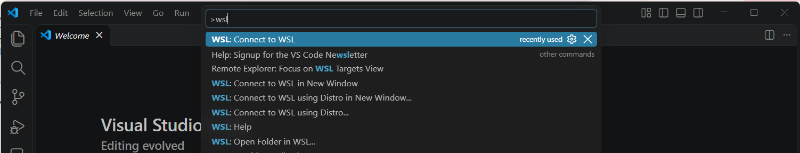
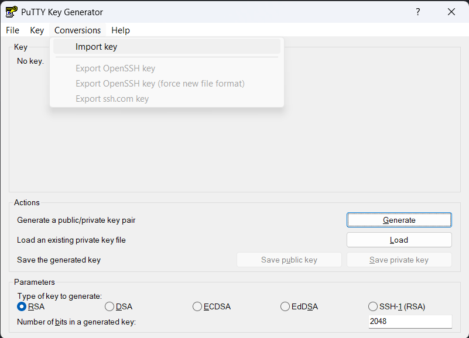
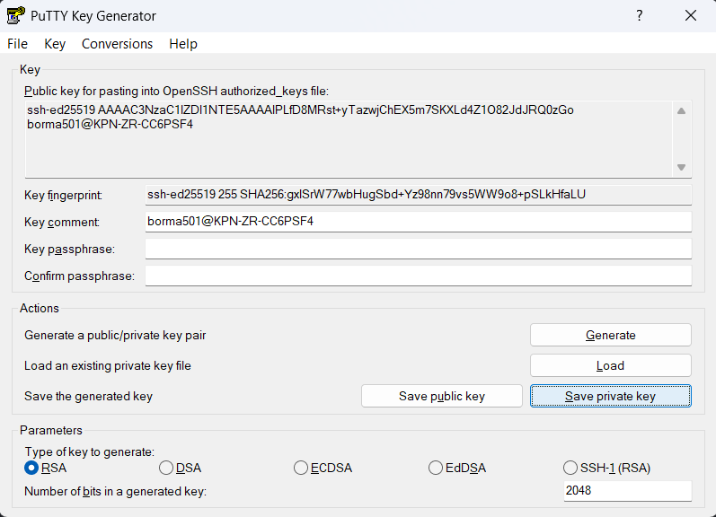
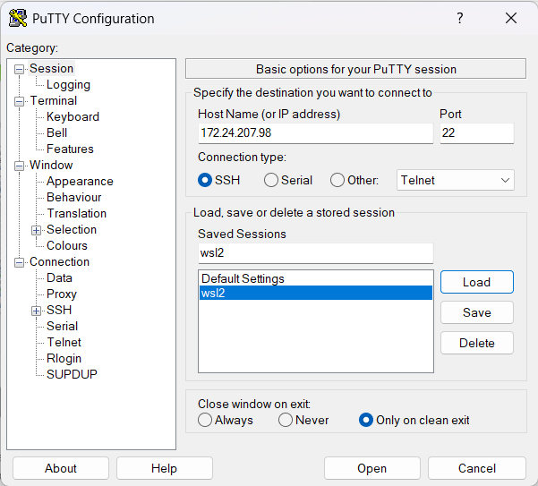
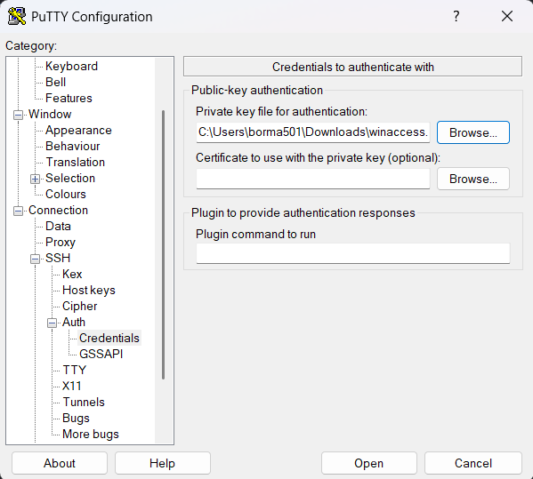
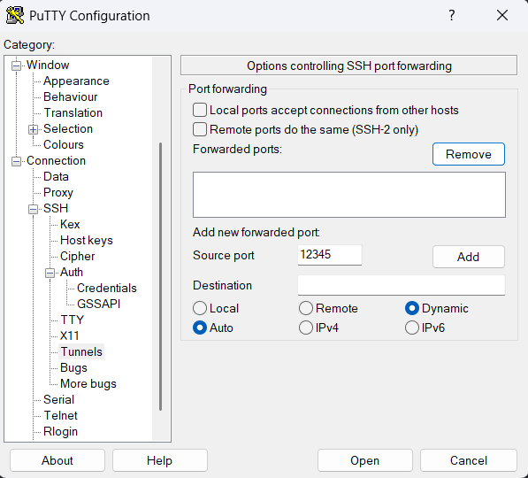
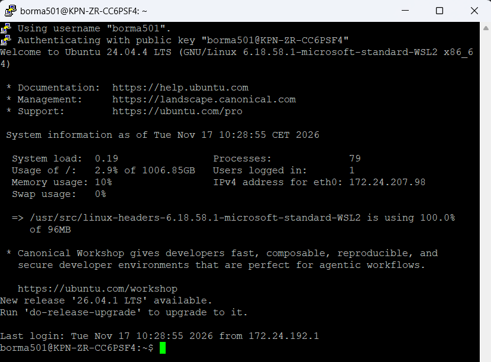
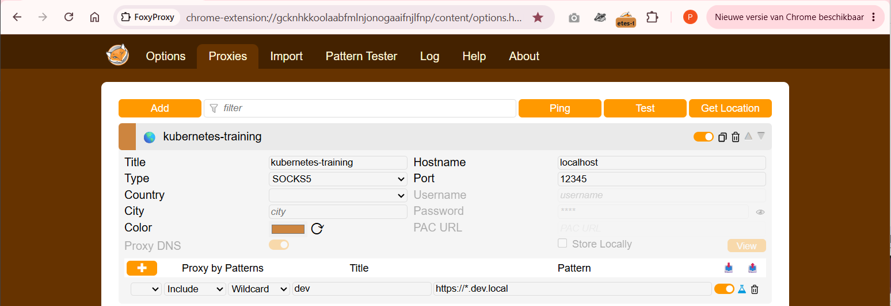
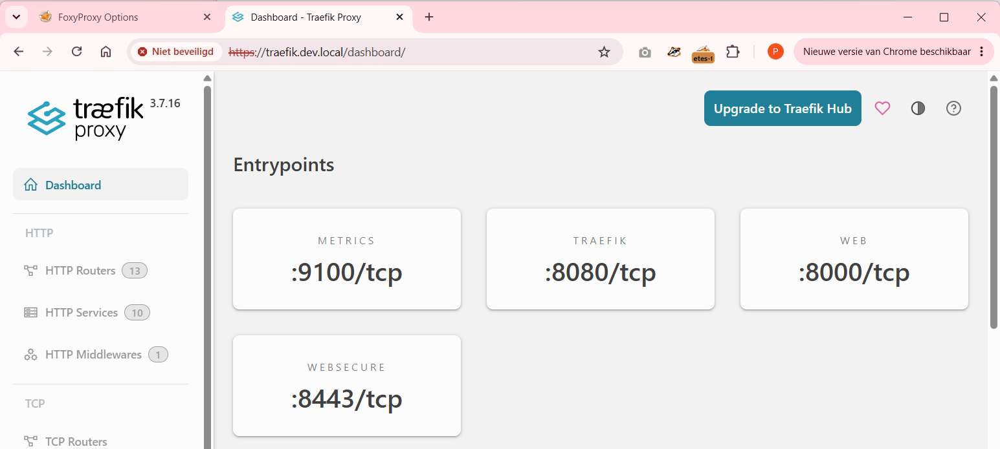

# Wsl

This provider describes how to run the stack on Ubuntu 24.04 on Wsl2 (on Windows). It's not the preferred provider but if a Windows laptop is all you have, this is a way forward.

## Enable wsl2

Wsl2 may be (and is) disabled by policy, use an IAM request to enable it (Windows Subsystem For Linux)

## Configure

Override for WSL2 confs
```
# C:\Users\<your-username>\.wslconfig
[wsl2]
kernelCommandLine = cgroup_no_v1=all
memory=16GB
```

## List the available distributions

```
wsl --list --online
```

## Install Ubuntu 24.04

```
wsl.exe --install Ubuntu-24.04
```

## Install and Configure VSCode

[Install](https://code.visualstudio.com/docs/setup/windows) and open VSCode and install the extension (Ctrl + Shift + X) "Visual Studio Code WSL".

Now hit (Ctrl + Shift + P) and search for wsl, click "WSL: Connect to wsl".



Once connected click (Ctrl + ` <= backtick that is) which opens a terminal where you can setup the git clone of the training.

For instance: 
```
git clone https://github.com/<user>/kubernetes-training.git
```

## OS Configs

Increase the max open file limit
```
# /etc/systemd/system.conf
DefaultLimitNOFILE=524288
```

Increase max file watches
```
# Append to /etc/sysctl.d/99-sysctl.conf and reload using sysctl -p
fs.inotify.max_queued_events=616384
fs.inotify.max_user_instances=512
fs.inotify.max_user_watches=786432
```

## putty

We will be using the tool putty to setup a tunnel from the Windows host to Ubuntu running in Wsl.

### Fetch the ip

Within wsl check the ip address of eth0

```
ip a
<...>
2: eth0: <BROADCAST,MULTICAST,UP,LOWER_UP> mtu 1500 qdisc mq state UP group default qlen 1000
    link/ether 00:15:5d:14:6a:b2 brd ff:ff:ff:ff:ff:ff
    inet 172.24.207.98/20 brd 172.24.207.255 scope global eth0
```

### Generate ssh key

Again within wsl run following commands
```
ssh-keygen -t ed25519 -f ~/.ssh/winaccess
cat ~/.ssh/winaccess.pub >> ~/.ssh/authorized_keys
```

### Install

Install Putty from the Microsoft Store.

### Convert sshkey to .ppk

Open puttygen on Windows and select Conversions - Import



Select the new private key from wsl (with a bit of luck Windows has added the Linux machine to the explorer, the ssh files can be found in the home/<user>/.ssh directory).

Click "Save private key" to export the .ppk to for instance your Downloads folder.



### Configure

Add a new session (and save it for later use). Fill in the ip and port as shown.



Navigate to Connection - SSH - Auth - Credentials and click Browse to select the private key in ppk format.



Navigate to Connection - SSH - Tunnels and add a forward configuration as in the example. Click Add.



Make sure to save this session configuration to a named session!

### Launch the tunnel

In Putty load the session and click Open, the session should open without any prompt for username/password.



## FoxyProxy

We will use the Chrome browser on Windows to connect to our exposed services, for this we need to setup a tool like FoxyProxy to forward requests into the tunnel (hosted by putty).

### Install plugin

In Chrome go to the [extensions](chrome://extensions/) and install FoxyProxy. When you cannot install any extensions (when your chrome session is managed by the organisation), simply create a second (personal) session where you can install the plugin and *import an extracted extension* in your managed session.

### Configure proxy

Match the following configuration



Then open one of the applications; making sure the proxy configuration is activated (select using the foxy proxy icon top right).


